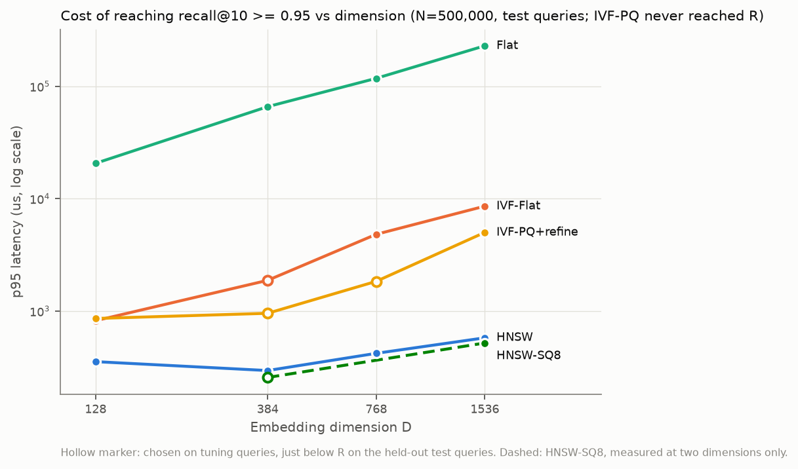
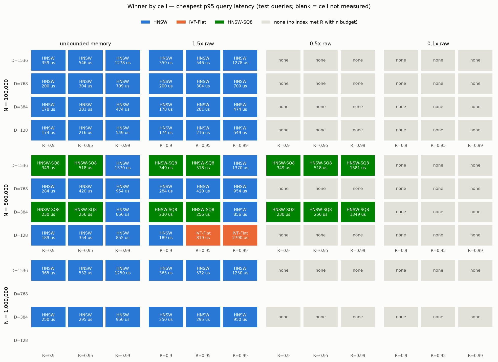

# Progress Report: Which ANN Index Is Cheapest at a Given Recall?

_A cost-surface study over dimensionality, scale, and filter selectivity._

**Status:** All four measurement stages are complete: A (dimension), B (scale), C (filtering) and D (updates). Every number below comes from a file under `results/`.

---

## 1. Problem definition

Teams that deploy vector search pick an approximate nearest-neighbour (ANN) index under a requirement such as "recall@10 of at least 0.95 within this memory". They need the **cheapest** index that meets it. Published benchmarks answer a different question: they plot recall against throughput for each dataset, and the reader has to find their own operating point.

This study treats recall as an **input constraint** and cost as the measured output. For each workload cell we find the cheapest configuration that reaches recall@10 ≥ R. A cell is defined by:

- corpus size **N**
- embedding dimension **D**
- filter selectivity **S**
- recall target **R**
- memory budget **M**

We then ask where the cheapest choice changes. The indexes compared are Flat (exact), HNSW, IVF-Flat, IVF-PQ, and IVF-PQ with exact re-ranking.

**Central question.** Filtered search can run as a filtered graph or list traversal, or as an exact scan of the matching subset. Below some selectivity S\*, the exact scan becomes cheaper. **Does S\* move with dimension D?**

## 2. Why it matters

- **Practitioners need an operating point, not a curve.** A required recall and a memory budget define a constrained optimisation, and its answer can flip as R rises from 0.90 to 0.99.
- **Existing benchmarks confound dimension with dataset.** Classic comparisons change D by changing the corpus (SIFT at 128-d, GIST at 960-d), so intrinsic difficulty and clustering are mixed into "the effect of D".
- **Filtered search is ubiquitous** in RAG and recommendation systems. The decision between in-index filtering and scanning the filtered subset is made constantly, usually by rule of thumb.

## 3. Related work (Phase 0 survey, 13 papers)

| Work | What it covers | What it leaves open |
|---|---|---|
| ANN-Benchmarks (Aumüller et al.) | Recall vs QPS across many libraries | D varies only by changing dataset |
| VIBE (Jääsaari et al., 2025) | Modern embedding benchmark, 22 implementations | No controlled D; recall is an outcome |
| Filtered ANN as a Phase Transition (Mandarapu & Kunkunuru, 2026) | Models the selectivity crossover as a phase boundary | Fixed D (SIFT1M, 128-d); D absent from its formulas |
| Amanbayev et al. (2026) | IVF-Flat beats HNSW at low selectivity | Single D (768) |
| Iff et al. (2025), ACORN (Patel et al., 2024) | Filtered-ANN benchmarks and methods | No controlled D |
| VADER (Chatzakis et al., 2026) | Recall as a declared constraint for filtered search | No dimension axis |
| Matryoshka Representation Learning (Kusupati et al., 2022) | Truncated embedding prefixes remain usable | Does not study index choice |

**Gap identified (Gate 0):** no prior paper measures how the filter-selectivity crossover moves with dimension on a single corpus. All references were verified against their arXiv pages.

## 4. Dataset

| Item | Value |
|---|---|
| Corpus | **MS MARCO passages**, 1,000,000 sampled uniformly (seed 0). 100K and 500K sets are nested prefixes, so scale changes without changing content |
| Queries | 10,000 MS MARCO training queries (seed 1), split once into **2,000 tuning / 8,000 test**. Parameters are chosen on tuning queries only; all reported numbers come from test queries |
| Embeddings | OpenAI `text-embedding-3-large`, 1536-d, **Matryoshka-truncated** to D = 128, 384, 768 and 1536, then L2-renormalised |
| Ground truth | Exact top-100 neighbours (FAISS flat L2) for all 12 (N, D) cells, verified against NumPy brute force |

Truncation changes ambient dimension far more than intrinsic difficulty. Local intrinsic dimensionality, estimated on a 10K-passage sample with the MLE estimator (k=20):

| D | 128 | 384 | 768 | 1536 |
|---|---|---|---|---|
| LID (mean ± sd) | 31.5 ± 11.4 | 32.4 ± 13.1 | 33.1 ± 13.6 | 34.2 ± 14.3 |

Ambient D rises 12×, while intrinsic dimension rises only about 8%.

## 5. Experimental setup

**Host.** AMD EPYC-Milan, 16 cores, 58.8 GB RAM, Linux. FAISS 1.15.1, CPU build with AVX2 (verified from the binary's compile options). Every result row is keyed to the host's hardware ID, and rows from different hosts are never mixed.

**Index grid** (all FAISS, L2 on unit-norm vectors):

| Index | Build parameters | Search sweep |
|---|---|---|
| Flat | none | none |
| HNSW | M ∈ {16, 32, 64}; efConstruction 200 (checked against 100 and 400) | efSearch 16 to 1024 |
| IVF-Flat | nlist = c·√N, c ∈ {2, 4, 8} | nprobe 1 to 512 |
| IVF-PQ | same nlist; m ∈ {D/16, D/8, D/4}; 8 bits | nprobe 1 to 512 |
| IVF-PQ + refine | as IVF-PQ, plus exact re-ranking | nprobe × k_factor ∈ {4, 16} |

**Protocol**

1. Sweep search effort on the tuning queries.
2. Pick the cheapest setting that reaches R (lowest p95 latency).
3. Re-measure that setting on the 8,000 held-out test queries.
4. Measure latency at batch size 1, single-threaded, pinned to one core, over 3 passes.
5. Build each selected configuration 3 times with different seeds.
6. Measure memory as the resident memory of a process that loads only the index.
7. Compute bootstrap confidence intervals (1,000 resamples) over queries.

**Stages run**

| Stage | Question | Grid | Compute |
|---|---|---|---|
| Pilot | Harness validation | N=100K, 4 D | ~1.2 h |
| A | Dimension | N=500K, D ∈ {128, 384, 768, 1536} | ~7.7 h |
| B | Scale | N ∈ {100K, 500K, 1M} × D ∈ {384, 1536} | ~17 h |
| C | Filtering | N ∈ {500K, 1M} × D ∈ {384, 1536}; S from 0.001 to 1; correlation none / positive / negative; 3 strategies | ~27 h |
| D | Updates | N=500K, D=768; insert 50K vectors into a 450K-vector index in 10 batches | ~4.5 h |

Total compute was about 56 h, with no unexplained failures. The harness passes all of its acceptance checks: Flat recall is 1.0, recall is monotone in search effort, and repeated latency runs agree within 10%.

## 6. Results

### 6.1 Headline: the filter crossover S\* moves with dimension

We measured S\*, the selectivity where in-index filtered search and exact scan of the filtered subset swap places, and compared D=384 against D=1536 for the same N, index, correlation and recall target.

| N | Index | Correlation | R | S\* at D=384 | S\* at D=1536 | Ratio |
|---|---|---|---|---|---|---|
| 500K | HNSW | none | 0.95 | 0.0128 | 0.0106 | 0.83 |
| 500K | HNSW | positive | 0.95 | 0.00127 | 0.00105 | 0.83 |
| 500K | HNSW | positive | 0.99 | 0.00251 | 0.00158 | 0.63 |
| 500K | IVF-Flat | positive | 0.90 | 0.00121 | 0.00131 | 1.08 |
| 500K | IVF-Flat | positive | 0.95 | 0.00129 | 0.00137 | 1.06 |
| 500K | IVF-Flat | positive | 0.99 | 0.00236 | 0.00163 | 0.69 |
| 1M | HNSW | positive | 0.99 | 0.00208 | 0.00112 | 0.54 |
| 1M | IVF-Flat | positive | 0.99 | 0.00414 | 0.00112 | 0.27 |

- The bootstrap intervals are **disjoint in all 8 pairs**.
- Median ratio S\*(1536) / S\*(384) is **0.76**. On this grid, the crossover generally shifts to lower selectivity as D rises; the two IVF-Flat pairs at R ≤ 0.95 move slightly the other way.
- **Correlation matters more than dimension.** Median S\* is 0.0106 for uncorrelated predicates against 0.00137 for positively correlated ones, about 8×.

### 6.2 Anti-correlated filters defeat approximate search at the swept effort

This table counts how many (cell, recall target) combinations each strategy could satisfy:

| Strategy | Uncorrelated | Positive | Negative (anti-correlated) |
|---|---|---|---|
| In-index filtered | 81 / 120 | 72 / 72 | **0 / 72** |
| Post-filter over-fetch | 155 / 240 | 144 / 144 | **0 / 144** |
| Pre-filter exact scan | 60 / 60 | 36 / 36 | 36 / 36 |

When the predicate admits only vectors far from the query, neither approximate strategy reached recall@10 ≥ 0.90 at any swept effort. Exact scan of the subset always did.

### 6.3 Product quantization has a recall ceiling below 0.90

Best recall@10 reached at any nprobe, at N=500K:

| D | 64× compression | 32× | 16× | 16× + exact re-rank |
|---|---|---|---|---|
| 128 | 0.369 | 0.541 | 0.745 | 0.999 |
| 384 | 0.514 | 0.669 | 0.836 | 0.998 |
| 768 | 0.581 | 0.723 | 0.869 | 0.998 |
| 1536 | 0.616 | 0.750 | **0.888** | 0.997 |

- Plain IVF-PQ **never reaches R=0.90**. Recall saturates in nprobe, so the limit is quantization error, not candidate coverage.
- Exact re-ranking over the same codes recovers recall of about 0.999.
- The planning document predicted the ceiling would *fall* with D. Measured at fixed 16× compression, it **rises**, from 0.745 to 0.888. The prediction is reversed.

**Consequence for memory budgets.** Within the tested grid, **no index meets a 0.5× or 0.1× raw-memory budget at R ≥ 0.90**. The only index small enough, IVF-PQ, cannot reach the recall. Within a 1.5× budget the winner changes in one place: IVF-Flat displaces HNSW at D=128, N=500K, where HNSW's graph links are comparable in size to the vectors.

### 6.4 Unfiltered cost surface: HNSW is cheapest everywhere

p95 latency in µs at N=500K, measured on test queries:

| R | Index | D=128 | D=384 | D=768 | D=1536 |
|---|---|---|---|---|---|
| 0.95 | Flat | 18,471 | 65,852 | 117,738 | 197,159 |
| 0.95 | **HNSW** | **321** | **262** | **420** | **495** |
| 0.95 | IVF-Flat | 650 | 1,873 | 4,811 | 7,677 |
| 0.95 | IVF-PQ + refine | 836 | 953 | 1,835 | 5,002 |

- HNSW is cheapest at every D and every R ∈ {0.90, 0.95, 0.99}, 58× to 398× faster than exact scan at R=0.95.
- From D=128 to D=1536, HNSW's p95 grows about **1.5×**, while exact scan grows about **10.7×**.

The figure below plots cost against dimension at R=0.95:

The winner heatmap below shows the cheapest index per (D, R) cell for the latency objective:

**Scale axis** (p95 in µs at R=0.95):

| D | Index | N=100K | N=500K | N=1M |
|---|---|---|---|---|
| 384 | Flat | 11,791 | 65,852 | 102,028 |
| 384 | HNSW | 303 | 262 | 295 |
| 1536 | Flat | 43,182 | 197,159 | 391,951 |
| 1536 | HNSW | 546 | 495 | 532 |

At fixed recall, HNSW's cost shows no measurable growth over a 10× larger corpus, while exact scan grows linearly.

### 6.5 Updates: inserts are nearly free in recall but costly in throughput for HNSW

| Index | Recall, first batch | Recall, last batch | Drift | Rebuild reference | Inserts/s (median) |
|---|---|---|---|---|---|
| HNSW | 0.99980 | 0.99971 | −0.00009 | 0.99972 | 1,571 |
| IVF-Flat | 0.99246 | 0.99256 | +0.00010 | 0.99228 | 56,113 |
| IVF-PQ | 0.71321 | 0.71356 | +0.00035 | 0.71245 | 58,576 |

- Adding 11% more vectors without retraining costs almost no recall for any index family.
- HNSW ingests about **37× slower** than the IVF families.

### 6.6 Decision rule (preliminary)

**Index choice.** A depth-3 tree predicting the cheapest index from (N, D, R, memory budget) only ties the trivial "always use HNSW" heuristic (test top-1 accuracy 1.0 for both). With no filter, one index wins everywhere, so there is nothing for a rule to learn.

**Filter strategy (exploratory, formulated after the index result).** A depth-3 tree instead chooses the cheapest filter strategy from:

- selectivity S
- dimension D
- recall target R
- a correlation proxy: the share of a query's nearest neighbours that pass the predicate, divided by the overall selectivity

On 66 held-out N=1M cells it reaches top-1 accuracy **0.667**. Always picking exact scan reaches 0.439, and always picking in-index filtering reaches 0.379. Its regret (extra cost relative to the best choice) is **0.10**, against **192** for always picking exact scan.

The proxy in this run was computed from exact neighbours, which a deployed system would not have, so 0.667 is an upper bound.

## 7. Future work

- **Rerun Stage C with finer filters.** At the smallest correlated level, S=0.001, measured selectivity overshot the target by 54–61%, because whole k-means clusters were too coarse. A rerun with more clusters and extra selectivity levels is needed before the low-S crossover values are final.
- **Exhaustive anti-correlated IVF search.** The nprobe sweep stopped at 512, below nlist (≥ 1,414). An nprobe = nlist check will show whether the failure persists when the scan is exhaustive.
- **Scalar quantization.** An 8-bit HNSW index has been added to test whether the sub-raw memory regime is genuinely empty or only absent from the original grid. Its sweeps are measured; finalisation is pending.
- **A deployable correlation proxy.** Compute the proxy from a cheap approximate probe instead of exact neighbours, and compare the rule against the same tree without the proxy and against a fixed 1%-selectivity switch.
- **Updates under distribution shift.** Stage D inserted a random sample of the same corpus, which cannot reveal stale IVF centroids. A shifted insert stream would.
- **Side checks and release.** Run an hnswlib cross-check, test k ∈ {1, 100}, add a drift canary across campaigns, add confidence intervals to the scaling fits, and publish an archived release with a persistent identifier.
